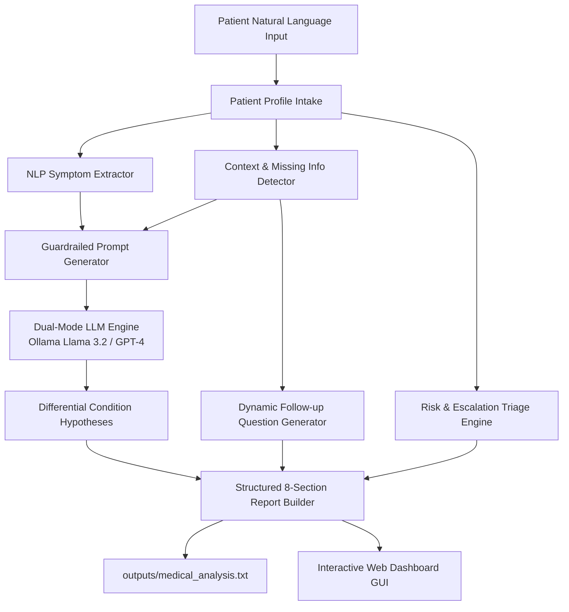
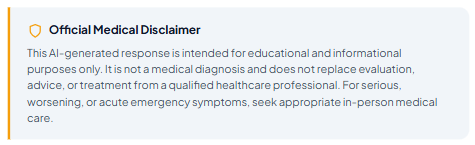

# AuraHealth: AI-Powered Medical Symptom Assistant 🩺🤖

[](https://www.python.org/)
[](https://ollama.ai/)
[](https://openai.com/)
[](https://flask.palletsprojects.com/)
[](https://opensource.org/licenses/MIT)

> **Course:** 24CS2506 – Building Applications using GPT-4  
> **Experiment:** Experiment 6 – AI-Powered Medical Symptom Assistant using GPT-4 / Ollama

---

## 📌 Overview

**AuraHealth** is an AI-powered clinical decision-support and medical symptom triage assistant. The system accepts user-reported conversational health descriptions, extracts discrete clinical symptoms using NLP, evaluates unstated critical contextual parameters, constructs guardrailed prompts, queries an LLM (local **Ollama Llama 3.2** with **OpenAI GPT-4** fallback), generates possible differential explanations with clinical reasoning, suggests targeted follow-up inquiries, assesses triage escalation risk, and formats the findings into a standardized 8-part structured medical report.

> ⚠️ **Important Medical Disclaimer**: AuraHealth is an educational and informational decision-support simulator. It is **NOT** a medical diagnostic tool and does not substitute for qualified clinical evaluation, diagnosis, or treatment.

---

## 🏗️ System Architecture



---

## 📸 Visual Showcase & Screen Walkthrough

### 1. Home Screen & Clinical Dashboard
The landing interface provides real-time system engine status (`Ollama Active (Local)`), a clean two-column clinical intake workspace, and immediate access to verified benchmark cases.


---

### 2. Patient Demographics & Natural Language Symptom Input
Accepts structured patient context (Age, Biological Sex, Duration, Severity, Medical History, Medications, Allergies) and free-form narrative descriptions with interactive quick-tag chips.

| Patient Demographic Intake | Natural Language Symptom Input |
| :---: | :---: |
|  |  |

---

### 3. NLP Symptom Extraction & Context Analysis
Converts free-form narratives into discrete canonical symptoms (e.g., *"My throat is also painful"* $\rightarrow$ `Sore throat`) and proactively detects missing clinical parameters (such as exact measured temperature, breathing difficulty, and progression).

| Extracted Clinical Symptoms | Detected Missing Context |
| :---: | :---: |
|  |  |

---

### 4. Guardrailed Prompt Construction & LLM Differential Analysis
Constructs a prompt enforcing non-diagnostic boundaries and general reasoning. The local LLM generates plausible differential possibilities accompanied by clinical justifications.

| Prompt Generation & Guardrails | GPT-4 / Ollama Differential Response |
| :---: | :---: |
|  |  |

---

### 5. Possible Conditions & Clinical Reasoning
Structured cards displaying differential hypotheses with associated clinical rationales.


---

### 6. Follow-Up Questions & Triage Escalation Guidance
Generates 5 tailored follow-up inquiries to resolve diagnostic ambiguity and stratifies patient risk (`Low`, `Moderate`, `High / Urgent`) with non-clinical medical escalation notices.

| Targeted Follow-Up Questions | Risk & Triage Escalation Banner |
| :---: | :---: |
|  |  |

---

### 7. Structured Report Assembly & Persistence
Assembles all clinical components into the mandatory 8-part report format and persists the record to `outputs/medical_analysis.txt`.

| Complete Structured Report | Mandatory Safety Disclaimer | Saved Output Confirmation |
| :---: | :---: | :---: |
|  |  |  |

---

## 📂 Repository File Structure

```text
Ex6/
├── .env                             # Environment configuration (Ollama host, optional OpenAI key)
├── .env.example                     # Environment template for repository clones
├── .gitignore                       # Standard Python, AI caching, and secret ignore rules
├── requirements.txt                 # Project dependencies list
├── README.md                        # Comprehensive system documentation
├── main.py                          # Dual-entry orchestrator (Interactive CLI & Web launcher)
├── app.py                           # Flask REST API server serving web dashboard
├── LAB RECORD-6.docx                # University laboratory report record
│
├── data/
│   └── sample_cases.csv             # 250 diverse clinical benchmark cases across 11 categories
│
├── frontend/                        # Web GUI Dashboard
│   ├── index.html                   # Semantic HTML5 clinical workstation
│   ├── css/
│   │   └── style.css                # Healthcare glassmorphic design system (Light/Dark themes)
│   └── js/
│       └── app.js                   # Client-side reactivity, API connectors, modal controllers
│
├── modules/                         # Core Decoupled Business Logic
│   ├── __init__.py                  # Package interface exposing all modules
│   ├── profile_module.py            # PatientProfile domain model & data validation
│   ├── input_module.py              # Interactive terminal input & CSV case loader
│   ├── symptom_module.py            # Clinical NLP pattern matching & phrase normalization
│   ├── context_module.py            # Missing clinical variables detection engine
│   ├── prompt_module.py             # Guardrailed non-diagnostic prompt builder
│   ├── analysis_module.py           # Dual LLM connector (Local Ollama / OpenAI GPT-4)
│   ├── question_module.py           # Targeted follow-up question generator
│   ├── safety_module.py             # Red-flag screening, risk level, & disclaimer enforcement
│   ├── save_module.py               # 8-part report compiler & persistent file writer
│   └── utils.py                     # Safe Windows console styling, banners, and table printers
│
├── outputs/
│   └── medical_analysis.txt         # Persistent 8-part clinical analysis report
│
└── screenshot/                      # All 13 verified demonstration screenshots
    ├── Home Screen.png
    ├── Patient Input.png
    ├── Symptom Input.png
    ├── Extracted Symptoms.png
    ├── Context Analysis.png
    ├── Prompt Generation.png
    ├── GPT-4 Response.png
    ├── Possible Conditions.png
    ├── Follow-up Questions.png
    ├── Triage Guidance.png
    ├── Structured Report.png
    ├── Disclaimer.png
    └── Saved Report.png
```

---

## ⚙️ Installation & Setup

### 1. Clone the Repository
```bash
git clone https://github.com/DeepakKrishnanSU/AI-Powered-Medical-Symptom-Assistant-using-GPT-4.git
cd AI-Powered-Medical-Symptom-Assistant-using-GPT-4
```

### 2. Set Up Virtual Environment (Recommended)
```bash
python -m venv .venv
# On Windows:
.venv\Scripts\activate
# On macOS/Linux:
source .venv/bin/activate
```

### 3. Install Dependencies
```bash
pip install -r requirements.txt
```

### 4. Configure Environment (`.env`)
Copy the example template to create your `.env`:
```bash
cp .env.example .env
```

Your `.env` comes preconfigured for local Ollama:
```env
# LLM Provider: 'ollama' or 'openai'
LLM_PROVIDER=ollama

# Local Ollama Configuration (Default - Zero API Cost)
OLLAMA_HOST=http://localhost:11434
OLLAMA_MODEL=llama3.2:latest

# Optional: Add your key if using OpenAI GPT-4
OPENAI_API_KEY=
OPENAI_MODEL=gpt-4o
```

---

## 🚀 How to Run

### Method 1: Interactive Web Dashboard GUI (Recommended)
```bash
python app.py
```
*(or `python main.py --web`)*  
Open your browser and navigate to **`http://localhost:5000`**.

---

### Method 2: Terminal Interactive Menu (Syllabus Option 11)
```bash
python main.py
```
Provides the full 9-option interactive terminal menu:
```text
=============================================================
                   APPLICATION MAIN MENU                     
=============================================================
  1. Enter Patient Information
  2. Enter Symptoms (Natural Language)
  3. Analyze Symptoms (Run GPT-4 / Ollama)
  4. Generate Follow-up Questions
  5. Display Possible Conditions
  6. Display Medical Attention Guidance
  7. Display Disclaimer
  8. Save Report (outputs/medical_analysis.txt)
  9. Exit
-------------------------------------------------------------
  L. Load Benchmark Case from CSV (Case 1 / Presets)
  D. Run Complete Automated Workflow Demo (All Steps)
  W. Launch Visual Web Dashboard (Browser GUI)
=============================================================
```

---

### Method 3: Automated Pipeline Demo
```bash
python main.py --demo
```
Executes all 8 clinical phases automatically for the reference benchmark case in a single command.

---

## 📊 Benchmark Reference Case (Lab Part A)

| Parameter | Laboratory Reference Value |
| :--- | :--- |
| **Age** | 22 years |
| **Biological Sex** | Female |
| **Duration** | 2 days |
| **Reported Severity** | Mild |
| **Medical History** | No known relevant condition |
| **Medications** | None |
| **Allergies** | None |
| **Natural Language Input** | *"I have been having fever and cough for two days. My throat is also painful."* |
| **Extracted Symptoms** | `Cough`, `Fever`, `Sore throat` |
| **Generated Differentials** | Common Cold / Viral URTI, Viral Pharyngitis, Influenza |
| **Risk Stratification** | Low Risk — Routine Outpatient Self-Care |

---

## 🛡️ Medical Safety & Ethical Constraints

AuraHealth strictly enforces the following clinical AI safety guardrails:
1. **Non-Diagnostic Framing**: All outputs are framed as *differential considerations* rather than definitive diagnoses.
2. **Red-Flag Interception**: Automatically screens for acute cardiovascular, neurological, or respiratory symptoms (e.g., crushing chest pain radiating to the arm, severe dyspnea, facial drooping) and immediately triggers emergency triage advice.
3. **No Clinical Invention**: The prompt architecture strictly forbids the model from assuming vital signs or inventing unstated clinical context.
4. **Mandatory Educational Disclaimer**: Verbatim safety warnings are enforced on all UI screens, terminal outputs, and persistent export files.

---

## 📄 License
This project is open-source and licensed under the [MIT License](LICENSE).
